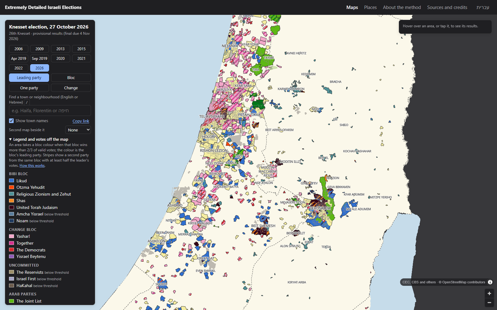

# Extremely Detailed Israeli Elections

### **[→ Open the map at israelielections.org](https://israelielections.org)**

Every Knesset election from 2006 to 2026, neighbourhood by neighbourhood. Results are mapped to CBS statistical
areas, the smallest unit Israel's Central Bureau of Statistics publishes: 3,857 areas, each a few thousand people.

## What's on the site

- **Ten elections on one set of boundaries.** 2006, 2009, 2013, 2015, April 2019, September 2019, 2020, 2021,
  2022 and 2026, all drawn on the CBS 2022 statistical areas, so any two can be compared directly.
- **Four ways to colour the map.** Leading party, bloc, a single party's share, or the change between two elections.
- **Side-by-side maps.** Put a second election beside the first and they pan and zoom together.
- **A page for every place.** More than 1,200 town, neighbourhood and Bedouin-locality pages with each election's
  results from 2006 to 2026. [Browse places →](https://israelielections.org/town/)
- **Search in English or Hebrew,** and a link that saves your exact view.
- **Fully bilingual.** The whole site is also in Hebrew.

## How the map is coloured

An area takes a colour only when one bloc won **more than two thirds** of its valid votes; the colour is that
bloc's leading party there. Otherwise it is pale yellow. Stripes show a second party from the same bloc with at
least half the leader's votes. Each election uses the camps Israeli media used at the time. The full method, and
what is approximate, is on the [About the method](https://israelielections.org/about.html) page.

The 2026 results are provisional (Central Elections Committee count file; regular ballot boxes only). Final
results and double-envelope votes will be added when they are published.

The layout and colour rule follow Sergei Kondrashov's map of the 2022 election. The name is a nod to the New York
Times' "An Extremely Detailed Map of the 2016 Election".

## Sources

- Results and polling-station lists: Israel Central Elections Committee.
- Statistical areas and census 2022 population: Israel Central Bureau of Statistics, under the CBS open licence.
- Station locations, land use and rough outlines: © OpenStreetMap contributors, ODbL.
- West Bank outline: Natural Earth (public domain).
- Map: MapLibre GL JS and PMTiles (BSD 3-Clause); Hebrew labels with mapbox-gl-rtl-text (BSD 2-Clause);
  Noto Sans (SIL Open Font License).

Full credits are on the [Sources and credits](https://israelielections.org/sources.html) page.

## Licence

See [`LICENSE.md`](LICENSE.md).

This is an independent, unofficial project with no connection to the Central Elections Committee, the Central
Bureau of Statistics or any party.
